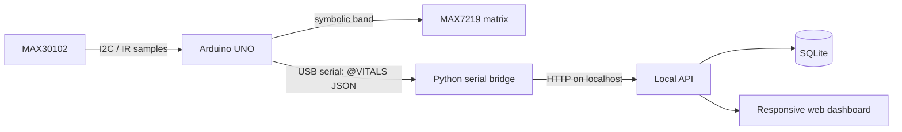

[README.md](https://github.com/user-attachments/files/33235238/README.md)

# CARE SIGNAL — Wearable Monitoring Prototype

**A human-centered monitoring concept for correctional environments.** This repository pairs an Arduino heart-rate sensing prototype with a local, responsive staff dashboard. It turns a MAX30102 pulse signal into a simple symbolic display and a small serial telemetry stream that can be reviewed on desktop or mobile-sized screens.

> **Prototype scope:** the supplied hardware reads contact-based pulse/heart-rate data only. The dashboard can also show clearly labeled synthetic demo records. This repository does not implement a garment, SpO₂, motion/activity sensing, wireless wearable telemetry, 24-hour operation, clinical alerts, or a production correctional-facility system.

**中文简介：** 面向惩教场景的人本化监测概念原型，将 Arduino 心率采集、点阵符号提示、本地数据接入和响应式管理看板串成一个可演示的流程。当前硬件仅实现 MAX30102 接触式心率原型；看板中的示例数据会明确标记为模拟数据。

## What is included

- **Arduino UNO firmware:** reads the MAX30102 IR FIFO, estimates heart rate with a beat-detection algorithm, and uses a MAX7219 8×8 matrix to show a symbolic band.
- **Serial telemetry:** emits one `@VITALS` JSON record per second for a local bridge. A fresh beat estimate is `null` when no recent beat is available.
- **Local ingest service:** a Python standard-library HTTP server validates incoming records and stores them in SQLite.
- **Responsive dashboard:** device status, recent heart-rate trend, and a manual-review queue. The interface can be viewed on desktop or a phone on the same computer.
- **Demo records:** synthetic data can be loaded from the dashboard to preview the interface without hardware.

## System flow



The bridge and server run on the same computer as a local prototype. The UNO itself has no Wi-Fi radio. The broader portfolio concept (garment sensors, mobile app, remote staff platform, and continuous monitoring) is documented as future work rather than presented as implemented hardware.

## Hardware

| Part | Connection |
| --- | --- |
| MAX30102 SDA | Arduino UNO A4 (SDA) |
| MAX30102 SCL | Arduino UNO A5 (SCL) |
| MAX30102 power | Follow the breakout board's voltage requirements; do not assume every board accepts 5 V |
| MAX7219 DIN | D11 |
| MAX7219 CS/LOAD | D10 |
| MAX7219 CLK | D12 |
| Ground | Common ground |

Install the Arduino libraries **LedControl** and **SoftwareWire** from Library Manager. `SoftwareWire` is included by the supplied driver because it exposes both software-I²C and `Wire` interfaces; this sketch uses hardware `Wire` on A4/A5.

## Run the local demo

Requirements: Python 3.10+ and an Arduino UNO with the listed modules for live sensor input. The dashboard itself can be previewed without the hardware.

1. Start the local server from the repository root:

   ```bash
   python backend/server.py
   ```

2. Open [http://127.0.0.1:8000](http://127.0.0.1:8000). Choose **Load demo data** to preview the interface using synthetic records.

3. For live input, upload `uno_max30102_max7219_hr.ino` from the Arduino IDE after installing the two libraries above. Close Serial Monitor, then install the bridge dependency and start the bridge in another terminal:

   ```bash
   python -m pip install -r backend/requirements.txt
   python backend/serial_bridge.py --port COM5
   ```

   Replace `COM5` with the UNO's serial port (for example, `/dev/ttyACM0` on Linux or `/dev/cu.usbmodem...` on macOS). The bridge forwards only lines prefixed with `@VITALS `.

## Telemetry contract

The firmware emits newline-delimited JSON prefixed with `@VITALS `:

```json
{"device_id":"uno-demo-01","ts_ms":123456,"heart_rate_bpm":72,"ir_raw":68420,"finger_detected":true,"session_active":true,"source":"max30102"}
```

`heart_rate_bpm` is `null` if a beat has not been detected in the last 2.5 seconds. `ts_ms` is device uptime, not wall-clock time; the server records its own UTC receive time. `ir_raw` is a raw optical signal level, not a health measure.

## Safety, privacy, and limitations

- This is an educational interaction and data-flow prototype, not a medical device or validated monitoring product. Do not use it to diagnose, triage, discipline, or make decisions about a person.
- The symbolic BPM bands are inherited from the supplied sketch and are only display states. They are not clinical thresholds. The demo review rule is illustrative and requires human verification.
- The sensor is intended for a still fingertip in this prototype. Motion, fit, perfusion, ambient light, and sensor quality can affect readings; no signal-quality validation is implemented.
- No real person identifiers are included. The demo uses synthetic device labels. Do not put inmate, patient, or other sensitive data into this prototype.
- The server binds to `127.0.0.1` by default and has no login, encryption, or production hardening. Keep it local and use synthetic data.

See [docs/architecture.md](docs/architecture.md), [docs/privacy-and-safety.md](docs/privacy-and-safety.md), and [THIRD_PARTY_NOTICES.md](THIRD_PARTY_NOTICES.md).

## Open-source references

The MAX30102 FIFO driver and PBA beat-detection implementation in the provided files follow the structure and attribution of SparkFun's MAX3010x sensor library. This project also uses the established local-first pattern of keeping acquisition, transport, storage, and presentation behind a small telemetry contract. References and attribution are listed in [THIRD_PARTY_NOTICES.md](THIRD_PARTY_NOTICES.md).

## License

Original project additions are under the MIT License. See [LICENSE](LICENSE) and `THIRD_PARTY_NOTICES.md` for files and dependencies with separate terms.
