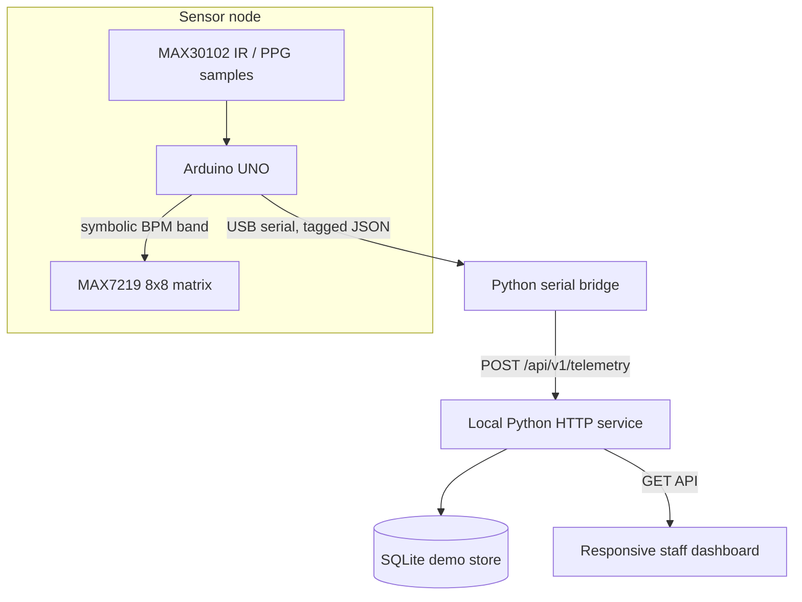

# Architecture and implementation scope

## Current prototype

The Arduino sketch keeps the supplied MAX30102 FIFO polling, optical beat detector, ten-second average, and four matrix symbols. A tagged JSON line was added for the serial bridge. The service validates basic field types and keeps a receive timestamp so the device's uptime clock is not treated as civil time.

## Data model

Each telemetry row contains a pseudonymous `device_id`, server `received_at` timestamp, optional `device_ts_ms`, optional `heart_rate_bpm`, raw `ir_raw`, `finger_detected`, `session_active`, `source`, and a `demo` flag. There is no person name, booking number, location, or diagnosis field.

Only heart rate and contact/sensor state are implemented by the included hardware. Synthetic demo records are generated separately and marked `demo=true`. They must not be presented as sensor measurements.

## Future concept (not implemented here)

The original project brief describes garment-based physiological sensing, motion/activity patterns, long-duration wear, wireless device networking, and staff desktop/mobile clients. Those components require additional hardware and engineering. Possible next increments are:

1. Validate a wearable sensor/garment and safe power budget for extended wear.
2. Add a motion sensor and explicit signal-quality states; do not infer behavior from heart rate alone.
3. Add authenticated transport, device provisioning, encrypted storage, role-based access, audit trails, retention controls, and a threat model before handling real data.
4. Co-design notice, consent/assent, access, correction, and human review workflows with affected people and facility staff.
5. Evaluate false alerts, missed alerts, sensor failures, bias, accessibility, and operational workload before any real-world pilot.

## Local API

- `GET /api/v1/dashboard` — device summaries and illustrative review queue.
- `GET /api/v1/readings?device_id=...&limit=60` — recent readings for a device.
- `POST /api/v1/telemetry` — validated serial-bridge payload.
- `POST /api/v1/demo/seed` — insert clearly marked synthetic records for UI preview.

The service uses only Python's standard library. It binds to loopback (`127.0.0.1`) by default and is not a production or network-accessible deployment.
